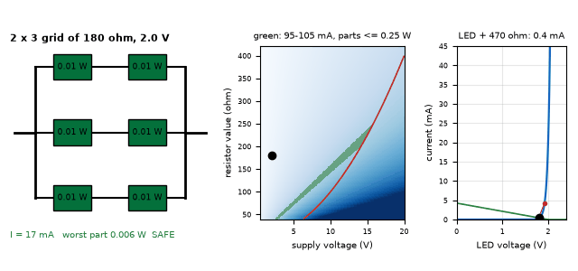
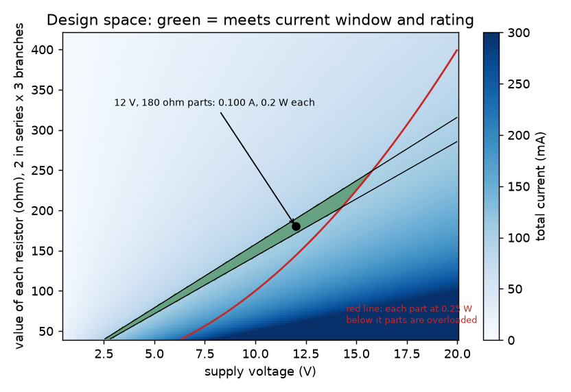
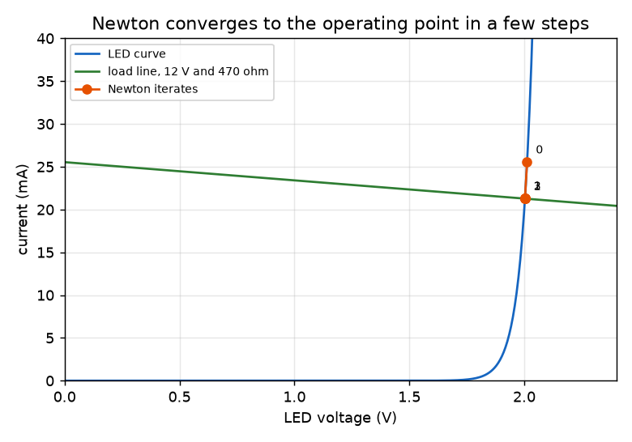
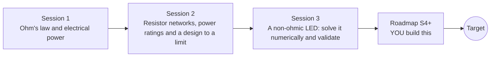

# openohm

[](https://github.com/KrunalPanchal1995/openohm/actions/workflows/ci.yml)   [](https://colab.research.google.com/github/KrunalPanchal1995/openohm/blob/main/sessions/session-01/lesson.ipynb) [](https://krunalpanchal1995.github.io/openohm/)

**Ohm's law to a safe resistor design, in three sessions.**

openohm teaches Ohm's law, electrical power and resistor networks, then solves a non-ohmic LED circuit numerically, using only Python and a browser.

- **Start from zero.** Session 1 needs only school arithmetic: one equation, V = I R, and one for power.
- **See it work.** Every session ships a slider app that runs in the browser, with labelled graphs and a challenge.
- **Know you got it right.** Each session ends with a checkpoint that prints PASS or FAIL against hand calculations.
- **Build the missing half.** The repo stops at Session 3 on purpose; the roadmap shows the path to the Target.

[Target](#the-target) · [Who is this for](#who-is-this-for) · [Quick start](#quick-start) · [Sessions](#sessions) · [Roadmap](#roadmap) · [Contribute](#contribute) · [Explainer PDF](docs/explainer.pdf)

> **This repo is incomplete on purpose.** Sessions 1 to 3 are here and fully working. The finished Target below is a preview of what the community can build next. We show you the path, not the code. Sessions 4 and up are yours.

## The Target

A circuit solver view sweeps a design space. On the left, a 12 V supply drives a series-parallel resistor network and each part glows red as it nears its 0.25 W rating. In the middle, a heat map of current against supply voltage and total resistance shows the safe region, with the operating point moving through it. On the right, Newton's method walks down an LED load line to the operating point, step by step. Your goal over the coming sessions: build the solver behind it, then extend it to any network and any limit.



*Target: a circuit solver sweeping the design space (network, safe-region heat map, Newton on an LED)*



*The design space: current and power limits carve out a safe region*



*Newton's method walking down to an LED operating point*

Try it live:

- [Math Visual Studio (open the Studio and explore curves and functions)](https://krunalpanchal1995.github.io/studio/)
- [Math Visual Studio: functions and their transformations (Atlas S03)](https://krunalpanchal1995.github.io/studio/#atlas?ch=S03&ex=1)

How the Target was made is shown only as a path in [promo/roadmap.md](promo/roadmap.md).

## Who is this for
**secondary school to diploma / undergraduate (levels 3-5).** Topic area: Electricity, Magnetism and Electronics.

Prerequisites:

- Rearranging a simple equation such as V = I R (school algebra).
- Python 3.10 or newer; if `python --version` works, you are ready. PRIMER.md explains the rest.
- No prior GitHub, electronics or calculus experience is needed. Real experiments use batteries only, never mains.

New to Python? Read [PRIMER.md](PRIMER.md) first (10 minutes).

## Quick start

No installation knowledge needed. You need [Git](https://git-scm.com/downloads) and [Python 3.10+](https://www.python.org/downloads/) (Windows: tick "Add Python to PATH"). On Mac and Linux type `python3` wherever this page says `python`.

```bash
git clone https://github.com/KrunalPanchal1995/openohm.git
cd openohm
python start.py 1
```

`start.py` creates a private environment, installs what is needed and runs Session 1 with its checkpoint. Next: `python start.py 2`, `python start.py 3`, or `python start.py test` to check everything. Only a checkpoint: `python start.py check 1`.

Five lines turn the idea of Session 1 into a result (they work as they are): Save it as `try.py` and run it with `python start.py run try.py` (this uses the private environment, where NumPy is installed):

```python
import numpy as np
V, R = 12.0, np.array([1.0, 6.0, 12.0, 24.0])   # volts, ohms
I = V / R                                       # Ohm's law, amperes
P = V * I                                       # power, watts
print(I, P)    # -> [12.  2.  1.  0.5] [144.  24.  12.   6.]
```

Every session also opens in your browser with sliders (no install): [live apps](https://krunalpanchal1995.github.io/openohm/). Or use the Colab badge above for the notebook.

## Sessions

| # | Session | Model level | Time | Live app |
|---|---|---|---|---|
| 1 | [Ohm's law and electrical power](sessions/session-01/README.md) | Level 1: conceptual interactive model | 60 min | [open](https://krunalpanchal1995.github.io/openohm/session-01/) |
| 2 | [Resistor networks, power ratings and a design to a limit](sessions/session-02/README.md) | Level 2: mathematical engineering model | 75 min | [open](https://krunalpanchal1995.github.io/openohm/session-02/) |
| 3 | [A non-ohmic LED: solve it numerically and validate](sessions/session-03/README.md) | Level 3: simulation and validation | 90 min | [open](https://krunalpanchal1995.github.io/openohm/session-03/) |

Each session follows the same six steps: A real-world problem, B concept and theory, C visual explanation, D interactive simulation, E worked example and experiment, F assessment and design challenge. Each ends with `checkpoint.py`, which prints `PASS` or `FAIL` against reference numbers. Session 3 also contains the real-world mini-project: **Design a safe LED indicator within a power budget**.

## Architecture



| Folder or file | What is inside |
|---|---|
| `sessions/` | three sessions: README (A-F), `lesson.py`, notebook, live app, exercises, activity sheet, checkpoint |
| `promo/` | the Target: media, live links, and the roadmap (path only) |
| `docs/` | `explainer.tex` and the built `explainer.pdf` |
| `tests/` | runs every lesson and checkpoint headless |
| `start.py` | one command to set up and run anything |
| `QUALITY.md`, `RUBRIC.md` | the quality checklist and the scoring rubric |
| `.github/` | CI, PDF build, Pages deploy, issue and PR templates |

## Roadmap

| Milestone | What you will build | Difficulty |
|---|---|---|
| Session 4: Network synthesis for any target | A function that, for any target resistance from 10 to 1000 ohm, returns the best network of at most two different E12 resistors. | intermediate |
| Session 5: Self-heating resistor | A heater model R(T) = R0 (1 + alpha (T - T0)) with a thermal resistance to the surroundings. | intermediate |
| Session 6: Tolerance and Monte Carlo | A Monte Carlo run of the 2 x 3 grid with random resistor values. | advanced |
| Session 7: Real battery and maximum power transfer | A battery with internal resistance r feeding a load R, with the power in the load swept over R. | advanced |
| Session 8: Add a capacitor: the RC time constant | A numerical step response of a resistor and capacitor in series. | advanced |

Full detail with a checkpoint per milestone: [promo/roadmap.md](promo/roadmap.md).

## Contribute
New to GitHub? Read [CONTRIBUTING.md](CONTRIBUTING.md); it starts from zero. Pick an issue labelled `good first issue`. Translations into Hindi, Telugu, Tamil and Malayalam are welcome.

<details>
<summary>Development</summary>

```bash
python start.py test        # runs every lesson and checkpoint
```
Lessons use `# %%` cell markers so they open as notebooks in VS Code. See [QUALITY.md](QUALITY.md) for the standard every session meets.
</details>

## License
MIT. See [LICENSE](LICENSE). Media in `promo/media` is (c) Krunal Panchal, CC BY 4.0.

## Acknowledgments
Part of the [PAN IIT OSS](https://hellofoss.tech-iitb.org/projects) open-source teaching collection, modelled on the structure of [openspline](https://github.com/openspline/openspline). Built on ideas from the Math Visual Studio at https://krunalpanchal1995.github.io/studio/.
