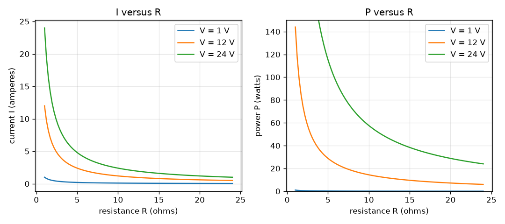
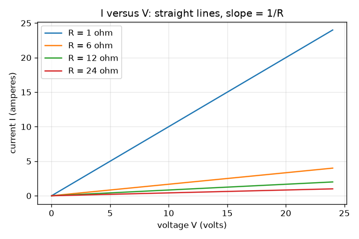

# Session 1: Ohm's law and electrical power

*Level 1 (conceptual interactive model) · about 60 minutes · openohm*

> This is a simplified educational model. It is not a validated design tool and must not be used for real structures, electrical installations, vehicles, industrial processes or medical decisions.

**Prerequisites**

- Rearranging a simple equation (if V = I R and you know V and R, find I).
- You have read PRIMER.md and run `python start.py 1` once.

**Learning objectives.** After this session you can:

- State Ohm's law V = I R and the power formula P = V I, with units.
- Compute current and power for a resistor from voltage and resistance, by hand and in Python.
- Show that P = V I = I^2 R = V^2 / R give the same number.
- Read the three graphs I versus V, I versus R and P versus R.

## A. Real-world problem
A phone charger, a torch bulb and a kettle each push electric current through something that resists it. Why does a thin wire get hot while a thick one does not, and why does a small resistor burn out if you connect it to too large a battery? Two short rules answer both: Ohm's law tells you how much current flows, and the power formula tells you how much heat appears. This repo uses low-voltage circuits only (batteries and small supplies, never mains).

## B. Concept and theory
Voltage V is the electrical push between two points. Resistance R is how strongly a part resists the flow. Current I is the flow of charge. For an ohmic part (one whose R stays constant) the three are linked by Ohm's law. The resistor turns electrical energy into heat at a rate called power, P = V I. Substituting Ohm's law gives two more forms that are often easier to use: P = I^2 R when you know the current, and P = V^2 / R when you know the voltage.

| Symbol | Meaning | Unit |
|---|---|---|
| V | voltage across the resistor | V (volts) |
| I | current through the resistor | A (amperes) |
| R | resistance | ohm |
| P | power turned into heat | W (watts) |

**Assumptions**

- The supply is ideal: it holds its voltage whatever the current.
- Wires have zero resistance.
- The resistor is ohmic: R does not change with current or temperature (Session 3 breaks this).
- Direct current (DC) only.

$$ V = I\,R \quad\Longleftrightarrow\quad I = \frac{V}{R} $$

$$ P = V\,I $$

$$ P = I^2 R = \frac{V^2}{R} $$

## C. Visual explanation
The first figure plots current against voltage for four resistors (1, 6, 12 and 24 ohm): each is a straight line through the origin and its slope is 1/R, so a small resistor gives a steep line. The second figure has two panels at 1, 12 and 24 V: current against resistance falls as 1/R, and power against resistance also falls as 1/R, because P = V^2 / R. At 12 V and 6 ohm the point is (2 A, 24 W).

*Current and power against resistance at 1, 12 and 24 V: both fall as 1/R.*

*Current against voltage for four resistors: straight lines with slope 1/R.*

## D. Interactive simulation
Run the lesson (`python start.py 1`), then open the live app: [Session 1: Ohm's law and power](https://krunalpanchal1995.github.io/openohm/session-01/) (or `app.html` in this folder). Move the voltage and resistance sliders and watch the circuit picture (arrow size follows the current, red follows the power). Then open the three graphs and see the dot move along each curve.

**Challenge.** Make the resistor draw 0.5 A while it dissipates 6 W.

## E. Worked example and experiment
**Problem.** A 12 V supply is connected across a 6 ohm resistor. Find the current and the power, and check the power in all three forms.

1. I = V / R = 12 V / 6 ohm = 2 A.
2. P = V I = 12 V x 2 A = 24 W.
3. Check with I^2 R = 2^2 x 6 = 4 x 6 = 24 W.
4. Check with V^2 / R = 144 / 6 = 24 W. All three forms agree.

**Answer.** The current is 2 A and the resistor dissipates 24 W.

**Experiment.** Use two AA cells in series (about 3 V) and a 100 ohm resistor rated at least 0.25 W; the model says I = 3 / 100 = 0.03 A (30 mA) and P = 0.09 W. Measure the current with a multimeter in series. Expect a value slightly below 30 mA: the resistor has a tolerance of 5 percent or so, the cells have a small internal resistance of their own, and the meter adds a little resistance. The model is exact for an ideal supply and ideal parts, the bench is not.

## F. Assessment and design challenge
**Question type A: Conceptual.** If you double the voltage across a resistor, what happens to the current and to the power? Explain why they change by different factors.

Hint

Use I = V / R first, then P = V I with the new current.

Step-by-step solution

The current doubles because I = V / R is proportional to V. The power is V times I, and both doubled, so P rises by 2 x 2 = 4 (also V^2 / R: V^2 quadruples). Power depends on voltage twice: once because the push is larger, once because the flow is larger.

**Question type B: Numerical.** What current does a 24 ohm resistor draw from an ideal 12 V supply, and how much power does it dissipate? Do a sanity check.

Hint

I = V / R, then P = V I.

Step-by-step solution

I = 12 / 24 = 0.5 A and P = 12 x 0.5 = 6 W. Sanity check: the 6 ohm resistor of the worked example drew 2 A, and this resistor is four times larger, so the current should be four times smaller: 2 / 4 = 0.5 A. Units: volts divided by ohms gives amperes; volts times amperes gives watts.

**Question type C: Graph and simulation interpretation.** On the P versus R graph at 12 V, what is P at 6, 12 and 24 ohm? What does the pattern tell you about halving the resistance?

Hint

Read the dot for each resistor, or use P = V^2 / R = 144 / R.

Step-by-step solution

P = 24 W at 6 ohm, 12 W at 12 ohm and 6 W at 24 ohm. Each time R is halved, P doubles, because P = 144 / R is inversely proportional to R at fixed voltage. Cutting the resistance of a part on a fixed supply makes it hotter, not cooler.

**Question type D: Design and optimisation challenge.** Design: from the preset resistors 1, 6, 12 and 24 ohm, choose one for a 12 V supply so that the current is at most 1 A and the resistor dissipates at most 10 W. What is the smallest resistance, not limited to presets, that meets both limits?

Hint

Each limit gives a minimum R: R >= V / I_max and R >= V^2 / P_max.

Step-by-step solution

Current limit: R >= 12 / 1 = 12 ohm. Power limit: R >= 144 / 10 = 14.4 ohm. Both must hold, so R >= 14.4 ohm. Among the presets only 24 ohm qualifies (12 ohm gives exactly 1 A but 12 W, over 10 W). The 24 ohm choice gives 0.5 A and 6 W. Trade-off: a larger R is safer but delivers less current to the load.

Score yourself with [RUBRIC.md](../../RUBRIC.md). Print the [activity sheet](activity_sheet.md) to work on paper.

## Common misconceptions
| Common misconception | What is actually true |
|---|---|
| More resistance always means more heat. | At fixed voltage, more resistance means less current and less heat (P = V^2 / R). At fixed current, more resistance means more heat (P = I^2 R). Say which one is fixed. |
| Current is used up as it passes through a resistor. | The same current leaves the resistor as enters it; it is the energy per charge (the voltage) that is turned into heat. |
| Ohm's law holds for every electrical part. | It holds only for ohmic parts whose resistance is constant. LEDs and bulb filaments do not follow it (Session 3). |

## Glossary
- **voltage**: the electrical push between two points, in volts
- **current**: the flow of charge, in amperes
- **resistance**: how strongly a part resists current, in ohms
- **power**: energy turned into heat per second, in watts
- **ohmic**: a part whose resistance stays constant, so I is proportional to V

## Finish
1. Do the three coding tasks in [exercises.md](exercises.md).
2. Run `python start.py 1` again after your changes. It ends with the checkpoint; when it prints `PASS`, you are done. (Checkpoint only: `python start.py check 1`.)

Next: [Session 2](../session-02/README.md)
