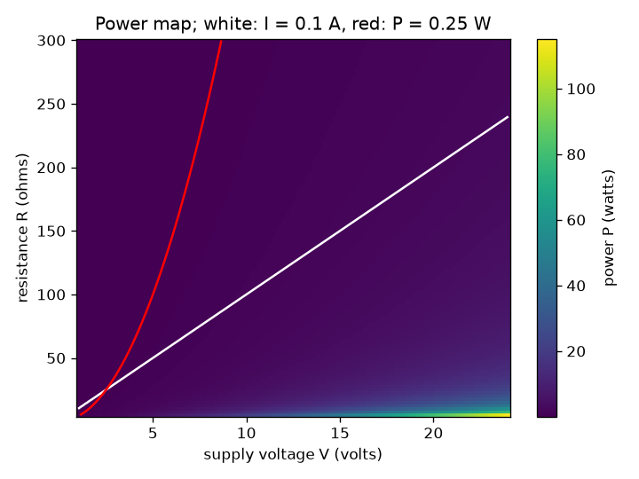
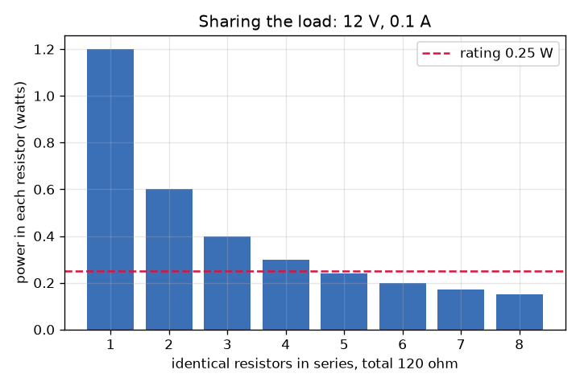

# Session 2: Resistor networks, power ratings and a design to a limit

*Level 2 (mathematical engineering model) · about 75 minutes · openohm*

> This is a simplified educational model. It is not a validated design tool and must not be used for real structures, electrical installations, vehicles, industrial processes or medical decisions.

**Prerequisites**

- Session 1: V = I R and P = V I.
- Fractions: adding 1/6 + 1/12.

**Learning objectives.** After this session you can:

- Compute the equivalent resistance of series and parallel combinations.
- Find the current and the power in every resistor of a network.
- Check each resistor against its power rating.
- Solve a design problem: choose standard E12 values that meet a current and a power limit.

## A. Real-world problem
You have a 12 V supply, a bag of small resistors, each rated 0.25 W, and you want about 0.1 A to flow. One 120 ohm resistor would carry the right current but would try to dissipate 1.2 W, nearly five times its rating, and it would overheat. Can several resistors share the job safely, and what is the fewest you need? (Low-voltage educational model: never design mains equipment this way.)

## B. Concept and theory
In series (one path) the same current flows through every resistor and the resistances add. In parallel (several paths between the same two points) every branch has the same voltage and the conductances (1/R) add, so the total is smaller than the smallest branch. Once the total resistance is known, Ohm's law gives the total current. The current then splits among parallel branches, and each resistor's power is I^2 R with its own current. A grid of ns resistors in series per branch and np branches in parallel, each of value r, has total R = ns r / np, and each resistor carries I / np. Every part has a power rating, the largest power it can dissipate continuously.

| Symbol | Meaning | Unit |
|---|---|---|
| R_total | equivalent resistance of the network | ohm |
| ns | resistors in series in each branch | no unit |
| np | branches in parallel | no unit |
| r | value of each resistor | ohm |
| P_each | power in each resistor | W |
| rating | largest allowed power per resistor (0.25 W here) | W |

**Assumptions**

- Ideal supply and ideal wires.
- All resistors in a grid are identical and ohmic.
- Standard E12 values are used (1, 1.2, 1.5, 1.8, 2.2, 2.7, 3.3, 3.9, 4.7, 5.6, 6.8, 8.2 times a power of ten).
- Real resistors also have a tolerance (for example 5 percent) which this session ignores.

$$ R_{\mathrm{series}} = R_1 + R_2 + \dots $$

$$ \frac{1}{R_{\mathrm{parallel}}} = \frac{1}{R_1} + \frac{1}{R_2} + \dots $$

$$ R_{\mathrm{total}} = \frac{n_s\, r}{n_p},\qquad I = \frac{V}{R_{\mathrm{total}}},\qquad P_{\mathrm{each}} = \left(\frac{I}{n_p}\right)^2 r $$

## C. Visual explanation
The first figure shows the power in each resistor when a total of 120 ohm at 12 V (0.1 A) is split into n identical resistors in series: 1.2 W for one, 0.6 W for two, 0.4 W for three, 0.2 W for six; the red dashed line is the 0.25 W rating. The second figure is a map of power against supply voltage and total resistance with the 0.1 A contour in white and the 0.25 W contour in red: the safe region lies on the high-resistance, low-voltage side of the red line.

*Power against supply voltage and total resistance; white: 0.1 A, red: 0.25 W.*

*Splitting a 120 ohm load into n identical series parts lowers the power in each part: it drops below the 0.25 W rating at n = 5.*

## D. Interactive simulation
Run the lesson (`python start.py 2`), then open the live app: [Session 2: resistor networks and power ratings](https://krunalpanchal1995.github.io/openohm/session-02/) (or `app.html` in this folder). Change the voltage, the resistor value and the numbers of series and parallel resistors. Watch the resistors turn red when they pass 0.25 W, and open the power and current graphs to see where the curve crosses the rating line.

**Challenge.** Draw 0.1 A (within 0.005 A) from the supply with every resistor at or below 0.25 W.

## E. Worked example and experiment
**Problem.** A 12 V supply feeds a grid of six 180 ohm resistors: two in series per branch, three branches in parallel. Find the total resistance, the current, and the power in each resistor.

1. One branch is two resistors in series: 180 + 180 = 360 ohm.
2. Three equal 360 ohm branches in parallel: R_total = 360 / 3 = 120 ohm.
3. Total current I = 12 / 120 = 0.1 A.
4. Each branch carries 0.1 / 3 = 0.0333 A.
5. Power in each resistor = (0.0333)^2 x 180 = 0.200 W, below the 0.25 W rating.
6. Check: six resistors x 0.2 W = 1.2 W = V I = 12 x 0.1. The powers add up.

**Answer.** R_total = 120 ohm, I = 0.1 A, each resistor 0.200 W (total 1.2 W).

**Experiment.** Build the grid from six 180 ohm resistors (0.25 W), power it from a bench supply set to 12 V with the current limit at 0.2 A, and measure the current with a multimeter. The model says 100 mA. With 5 percent resistors the real value can differ by a few percent, and after a few minutes the resistors are warm because each dissipates 0.2 W, 80 percent of its rating. Warm resistors are normal; a rating is a limit, not a target, and real designs leave a margin.

## F. Assessment and design challenge
**Question type A: Conceptual.** Why does adding a resistor in parallel make the total resistance smaller, even though you added more material?

Hint

Think of the number of paths the current can take.

Step-by-step solution

A parallel resistor opens one more path for the current. With every branch at the same voltage, each branch carries its own current and the total current is the sum, so for the same voltage the total current rises and the equivalent resistance V / I falls. It is always smaller than the smallest branch.

**Question type B: Numerical.** A 12 V supply feeds a 6 ohm resistor in series with two 12 ohm resistors in parallel. Find the total current, the power in the 6 ohm resistor and the power in each 12 ohm resistor.

Hint

First combine the two 12 ohm resistors, then add the 6 ohm resistor.

Step-by-step solution

Two 12 ohm resistors in parallel give 6 ohm. In series with 6 ohm: R_total = 12 ohm, so I = 12 / 12 = 1 A. The 6 ohm resistor carries 1 A: P = 1^2 x 6 = 6 W. The current splits equally, 0.5 A in each 12 ohm resistor: P = 0.5^2 x 12 = 3 W each. Check: 6 + 3 + 3 = 12 W = 12 V x 1 A.

**Question type C: Graph and simulation interpretation.** In the power graph for a single 120 ohm resistor, at what supply voltage does the curve cross the 0.25 W rating? Where does it cross for the 2 x 3 grid of 180 ohm resistors?

Hint

Solve V^2 / R = 0.25 for the single resistor; for the grid, P_each = (V / 120 / 3)^2 x 180.

Step-by-step solution

Single resistor: V = sqrt(0.25 x 120) = sqrt(30) = 5.48 V. Grid: P_each = V^2 x 180 / 129600 = V^2 / 720, which equals 0.25 at V = sqrt(180) = 13.4 V. So the grid is safe at 12 V, but only with about 1.4 V of margin.

**Question type D: Design and optimisation challenge.** Design: with a 12 V supply and 0.25 W resistors, get 50 mA within 5 percent using the fewest E12 resistors. State the network and its checks.

Hint

Target R_total is 240 ohm. One resistor would dissipate 0.6 W. Try series chains of identical E12 values.

Step-by-step solution

Three 82 ohm resistors in series give 246 ohm: I = 12 / 246 = 48.8 mA (2.4 percent low, inside 5 percent), each resistor dissipates 0.0488^2 x 82 = 0.195 W, below 0.25 W. One or two resistors cannot meet the power rating at 50 mA. Trade-off: more parts cost more and take space; the margin is 22 percent below the rating. Assumption: tolerance of the parts is ignored.

Score yourself with [RUBRIC.md](../../RUBRIC.md). Print the [activity sheet](activity_sheet.md) to work on paper.

## Common misconceptions
| Common misconception | What is actually true |
|---|---|
| Current is the same everywhere in every circuit. | Only in series. In parallel branches the current splits; the voltage is the same instead. |
| Two equal resistors in parallel double the resistance. | They halve it. The total of n equal resistors in parallel is r / n. |
| A resistor's power rating is how much it uses. | It is the most it can dissipate without being damaged. The actual power is set by the circuit (I^2 R). |

## Glossary
- **series**: components in one path, sharing the same current
- **parallel**: components across the same two points, sharing the same voltage
- **equivalent resistance**: the single resistor that would draw the same current from the same supply
- **power rating**: the largest power a part can dissipate continuously
- **E12**: a standard set of 12 resistor values per factor of ten

## Finish
1. Do the three coding tasks in [exercises.md](exercises.md).
2. Run `python start.py 2` again after your changes. It ends with the checkpoint; when it prints `PASS`, you are done. (Checkpoint only: `python start.py check 2`.)

Next: [Session 3](../session-03/README.md)
