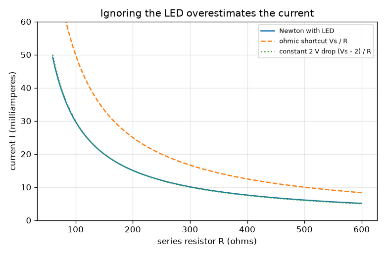
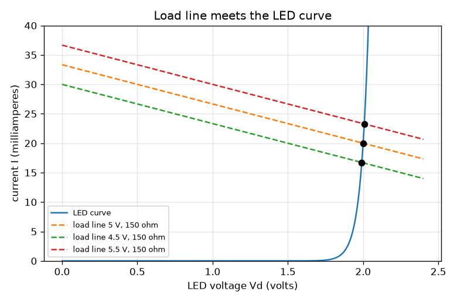

# Session 3: A non-ohmic LED: solve it numerically and validate

*Level 3 (simulation and validation) · about 90 minutes · openohm*

> This is a simplified educational model. It is not a validated design tool and must not be used for real structures, electrical installations, vehicles, industrial processes or medical decisions.

**Prerequisites**

- Session 1: Ohm's law and power.
- Session 2: series circuits and power ratings.
- The idea of a slope (how fast one quantity changes with another).

**Learning objectives.** After this session you can:

- Explain why an LED does not obey Ohm's law and why it needs a series resistor.
- Solve the circuit equation numerically with Newton's method and with bisection.
- Validate the solver against a reference, the ohmic limit and a hand calculation.
- Measure how the current changes with the supply voltage and choose a resistor within a power budget.

## A. Real-world problem
Connect an LED straight to a battery and it burns out in a flash. An LED is not a resistor: below about 1.5 V almost no current flows, and just above it the current climbs steeply. A series resistor limits the current. But what current actually flows, and how much does it change if the supply is 10 percent off? Ohm's law alone cannot say, because the LED has no single resistance. (Simplified low-voltage model, not a datasheet; never use it for mains.)

## B. Concept and theory
An LED follows an exponential current-voltage law, I = I_s (exp(Vd / N_VT) - 1), where I_s is a tiny saturation current and N_VT sets how sharp the turn-on is. Here the model is tuned so that 20 mA gives 2.0 V. In series with a resistor R on a supply Vs, Kirchhoff's voltage law says Vs = I R + Vd. Substituting the LED law gives one equation in Vd that has no neat algebraic solution, so we solve it numerically. Newton's method improves a guess by following the tangent: Vd_new = Vd - f / f'. Bisection halves a bracket that contains the root and is slow but safe, so it serves as a reference. A small change dVs in the supply changes the current by dI = dVs / (R + r_d), where r_d = N_VT / I is the LED's dynamic resistance, the slope of its curve at the operating point.

| Symbol | Meaning | Unit |
|---|---|---|
| Vs | supply voltage | V |
| R | series resistor | ohm |
| Vd | voltage across the LED | V |
| I | loop current | A |
| I_s | saturation current of the model | A |
| N_VT | ideality factor times thermal voltage (0.05 here) | V |
| r_d | dynamic resistance of the LED, N_VT / I | ohm |

**Assumptions**

- Ideal supply and wires; direct current.
- A single-exponential LED model tuned to 2.0 V at 20 mA; real LEDs also drift with temperature and differ by colour.
- No self-heating of the LED or resistor.
- The supply tolerance is the only uncertainty considered.

$$ I = I_s\left(e^{V_d/N_{VT}} - 1\right) $$

$$ V_s = I R + V_d \;\;\Rightarrow\;\; f(V_d) = I_s\left(e^{V_d/N_{VT}} - 1\right) - \frac{V_s - V_d}{R} = 0 $$

$$ V_d \leftarrow V_d - \frac{f(V_d)}{f'(V_d)},\qquad f'(V_d) = \frac{I_s}{N_{VT}}e^{V_d/N_{VT}} + \frac{1}{R} $$

$$ \frac{dI}{dV_s} = \frac{1}{R + r_d},\qquad r_d = \frac{N_{VT}}{I} $$

## C. Visual explanation
The first figure draws the LED curve and three straight load lines, I = (Vs - Vd) / R, for 4.5, 5 and 5.5 V with R = 150 ohm. Each load line meets the LED curve at an operating point (black dot): the LED voltage hardly moves (about 1.99 to 2.01 V) while the current moves from 16.7 to 23.3 mA. The second figure compares the true current with the ohmic shortcut Vs / R (which ignores the LED and gives 33 mA at 150 ohm) and with a constant 2 V drop, which is close for large R.

*Current against series resistance: the ohmic shortcut overestimates, a constant 2 V drop is close.*

*Load lines for 4.5, 5 and 5.5 V meet the LED curve; the current moves a lot, the LED voltage barely.*

## D. Interactive simulation
Run the lesson (`python start.py 3`), then open the live app: [Session 3: an LED in series with a resistor](https://krunalpanchal1995.github.io/openohm/session-03/) (or `app.html` in this folder). Change the supply, the resistor and the supply tolerance. In the load-line view watch the green line slide along the LED curve and the grey lines mark the tolerance band; in the sensitivity view compare the true current with the grey ohmic shortcut.

**Challenge.** Keep the LED current between 10 mA and 25 mA over the whole supply tolerance and the total power at the highest supply at or below 0.12 W.

## E. Worked example and experiment
**Problem.** A 5 V supply feeds a 150 ohm resistor in series with the LED. Find the operating point, check it against Kirchhoff's law, and compare with the ohmic shortcut.

1. Guess that the LED drops about 2.0 V (the tuned point). The resistor then has 5 - 2 = 3 V across it.
2. I = 3 / 150 = 0.020 A = 20 mA, which is exactly the current at which the model gives 2.0 V, so the guess is consistent.
3. Newton's method started from 2.5 V reaches Vd = 2.000 V, I = 20.00 mA in 16 steps; bisection gives the same values.
4. Kirchhoff check: I R + Vd = 0.020 x 150 + 2.0 = 5.0 V = Vs.
5. Powers: resistor 0.020^2 x 150 = 0.060 W, LED 2.0 x 0.020 = 0.040 W, total 0.100 W = 5 x 0.02.
6. The ohmic shortcut Vs / R = 5 / 150 = 33.3 mA is 67 percent too high, because it ignores the 2 V that the LED takes.

**Answer.** Operating point: Vd = 2.000 V, I = 20.0 mA; resistor 60 mW, LED 40 mW. Ignoring the LED would give 33.3 mA.

**Experiment.** Using a 5 V USB supply (or three AA cells at about 4.5 V), a red LED and a 150 ohm resistor, measure the voltage across the resistor with a multimeter and divide by 150 to get the current. A typical red LED gives a current in the same ball park as the model, but not the same number: a real LED may drop 1.7 to 2.1 V depending on colour and part, and its drop falls as it warms. The model is tuned to one LED; a real part has its own curve. Never connect an LED without a resistor.

## Real-world application and mini-project: Design a safe LED indicator within a power budget
A 5 V supply is only guaranteed to within 10 percent (4.5 to 5.5 V). A red LED must stay visible (at least 10 mA) but never exceed its 25 mA limit, and the whole circuit may use at most 0.12 W at the highest supply voltage. Choose a standard E12 series resistor using `pick_resistor` and `solve_newton` from Session 3. This is general education about a simplified LED model, not a datasheet-based design.

**Deliverable:** A script that prints the safe E12 choices, then for your chosen resistor prints the LED current at 4.5 V, 5.0 V and 5.5 V, the resistor power and the total power at 5.5 V, and saves a load-line picture.

**Success looks like:** Current between 10 mA and 25 mA at both ends of the supply range, total power at 5.5 V at most 0.12 W, resistor power well below 0.25 W.

## F. Assessment and design challenge
**Question type A: Conceptual.** Why does an LED need a series resistor, but an ordinary resistor does not?

Hint

Compare how the current changes when the voltage across each rises by a small amount.

Step-by-step solution

For a resistor the current rises in proportion to the voltage, gently. For an LED the current rises exponentially: a few hundredths of a volt more across the LED can multiply the current several times, so any small error in the supply would destroy it. The series resistor takes most of the extra voltage and fixes the current to roughly (Vs - Vd) / R.

**Question type B: Numerical.** For Vs = 5 V and R = 150 ohm use the sensitivity formula to estimate how much the LED current changes if the supply rises by 0.5 V. Compare with the value from the model (23.3 mA at 5.5 V).

Hint

dI/dVs = 1 / (R + N_VT / I) with I = 20 mA and N_VT = 0.05 V.

Step-by-step solution

r_d = 0.05 / 0.020 = 2.5 ohm, so dI/dVs = 1 / 152.5 = 6.56 mA per volt. For 0.5 V: change = 3.3 mA, estimate 23.3 mA. The model gives 23.28 mA, so they agree. The tiny r_d means the resistor, not the LED, sets the sensitivity: dI/dVs is almost 1 / R.

**Question type C: Graph and simulation interpretation.** In the load-line figure the three operating points have LED voltages between 1.99 and 2.01 V but currents between 16.7 and 23.3 mA. What does that say about which part controls the current?

Hint

Look at the vertical spread of the dots against their horizontal spread.

Step-by-step solution

The LED curve is almost vertical there, so the LED voltage is nearly fixed (about 2 V) and the load line decides where the point sits along it: the resistor and the supply set the current. This is why designers use I = (Vs - Vd) / R with a fixed Vd of about 2 V.

**Question type D: Design and optimisation challenge.** Design: a 5 V supply (4.5 to 5.5 V) must give 10 to 25 mA in the LED and use at most 0.12 W in total at 5.5 V. Choose from the E12 series and justify.

Hint

Run pick_resistor(5.0, 0.10, 0.010, 0.025, 0.12) and look at the current range for each choice.

Step-by-step solution

The safe E12 values are 180 and 220 ohm. 150 ohm gives up to 23.3 mA but 0.128 W at 5.5 V, over budget; 270 ohm falls to 9.4 mA at 4.5 V, too dim. For 180 ohm the current is 14.0 to 19.4 mA and the total power at 5.5 V is 0.107 W; for 220 ohm it is 11.5 to 16.0 mA and 0.088 W. Choose 180 ohm for brightness or 220 ohm for the smaller power; both leave the 0.25 W resistor far below its rating. Assumption: a tolerance of the resistor itself is ignored (5 percent changes these numbers a little).

Score yourself with [RUBRIC.md](../../RUBRIC.md). Print the [activity sheet](activity_sheet.md) to work on paper.

## Common misconceptions
| Common misconception | What is actually true |
|---|---|
| The LED has a resistance, so I = V / R works across it. | The ratio V / I of an LED changes with the current; the local slope (dynamic resistance) is tiny near 20 mA. Ohm's law applies to the series resistor, not to the LED. |
| A faster solver is always better. | Newton is fast but can overshoot from a poor start; bisection is slow but always converges. Using the second as a check on the first is good practice. |
| A matching answer proves the model is right. | Agreement between two solvers shows that the numerics are correct for the model; only comparison with measurements shows the model is realistic. |

## Glossary
- **non-ohmic**: a part whose current is not proportional to its voltage
- **load line**: the straight line I = (Vs - Vd) / R of the circuit; its crossing with the part's curve is the operating point
- **Newton's method**: root finding by repeatedly following the tangent line to zero
- **bisection**: root finding by halving an interval that contains the root
- **dynamic resistance**: the slope dV/dI of a part's curve at the operating point

## Finish
1. Do the three coding tasks in [exercises.md](exercises.md).
2. Run `python start.py 3` again after your changes. It ends with the checkpoint; when it prints `PASS`, you are done. (Checkpoint only: `python start.py check 3`.)

Next: the [roadmap](../../promo/roadmap.md). Session 4 is yours to build.
